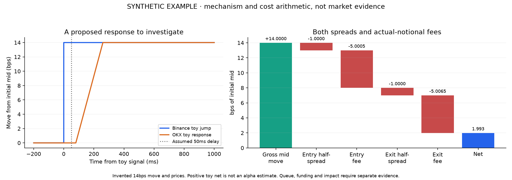
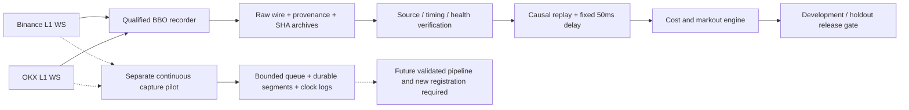

# crypto-exec-lab

[](https://github.com/evananann/crypto-exec-lab/actions/workflows/test.yml)

[](reports/engineering/README.md)
[](configs/successor/registered_study.json)



A BTC perpetual research case study: **does cross-venue price discovery survive
fees, latency and liquidation?** It uses public Binance, OKX and Bybit data,
frozen hypotheses, received-quote replay and explicit execution assumptions.

**Hypothesis:** an accumulated $2 Binance jump predicts a positive OKX
entry-to-mid markout after a 50ms decision delay and 5bps entry fee, measured
one second from the signal using local receive time. A separate prospective
study repeats the fixed test across dates and on Binance→Bybit.

**Current conclusion:** empirical outcomes remain unavailable in the committed
verified evidence. The [successor registration](configs/successor/registered_study.json)
records three qualified 15-minute infrastructure trials across October 22–23.
Its study window is October 25–November 21 UTC, with outcomes gated until
November 22, 08:00 Shanghai. Registration does not establish collected coverage
or profitable execution.
The project sends no live orders.

Start with the [research memo](docs/RESEARCH_MEMO.md),
[trading thesis and falsification plan](docs/TRADING_THESIS.md), and
[trader decision memo](docs/TRADER_DECISION_MEMO.md). The
[interactive cost-hurdle lab](reports/trading_decision/decision.html) explores
when an assumed positive primary markout could survive an executable exit.
Its 18 fixed cases are synthetic arithmetic, with no market estimates or orders.

Use the [data card](docs/DATA_CARD.md) for instrument, unit, clock and
coverage provenance, or the [reviewer packet](docs/REVIEWER_PACKET.md) for a short
reading order and reproducible audit questions.

Open the [executed five-minute synthetic walkthrough](notebooks/01_thesis_walkthrough.ipynb)
or [run it in Colab](https://colab.research.google.com/github/evananann/crypto-exec-lab/blob/main/notebooks/01_thesis_walkthrough.ipynb).
The [engineering audits](docs/ENGINEERING_REFINEMENTS.md) add measured columnar
as-of association, clock diagnostics, impact sensitivity and future-input
multiplicity/DSR/PBO checks. Performance and coverage numbers are measured
snapshots; no >95% coverage, calibrated impact or NTP-accuracy claim is assumed.



The [maker and conditional opportunity experiment](docs/MAKER_OPPORTUNITY.md)
adds queue/cancellation races, missed profitable fills, fixed tail conditions and
receive-clock correlation curves. Its [36-case report](reports/opportunity/README.md)
and hero graphic are synthetic; no predictive or maker edge has been established.

The [portfolio Pages preview](https://github.com/evananann/crypto-exec-lab/actions/runs/40701481904)
built successfully. **Live publication awaits repository administrator setup:**
GitHub returned HTTP 403 for automatic Pages configuration. Select **Settings →
Pages → Source: GitHub Actions**, then rerun the
[deployment workflow](.github/workflows/portfolio-pages.yml). The interactive
[cost lab HTML](reports/trading_decision/decision.html) remains available offline.

The [microstructure research tools](docs/MICROSTRUCTURE_RESEARCH.md) add causal
OFI, a separate dynamic trigger, latency/depth stresses and event clustering.
Their [continuous capture pilot](deploy/continuous-capture/README.md) is undeployed;
these tools require a future experiment and do not alter the registered study.

The [secondary model comparison](docs/MODEL_COMPARISON.md) adds causal BBO
features, executable round-trip labels, fixed ridge/logistic models and purged
chronological validation. Its [demo](reports/model_comparison/comparison.md) is
synthetic; empirical fitting remains release-gated.

The [empirical note](reports/empirical_research/README.md) records the current
pending state. [Publication automation](docs/EMPIRICAL_HANDOFF.md) will produce
a one-page interpretation only from an authenticated released scientific report.
Use the [defense pack](docs/RESEARCH_DEFENSE.md) to practice the research case;
spoken performance and feedback require the candidate's answers.

The [project status page](reports/project_status/index.html) separates software,
collection and research evidence. Use the [live status workflow](https://github.com/evananann/crypto-exec-lab/actions/workflows/project-status.yml)
for refreshed checks. The [successor collection path](docs/SUCCESSOR_COLLECTION.md)
adds durable slot claims and richer provenance. The October 23 registration fixed 56
slots across October 25–November 21 UTC; current collection coverage has not been
re-audited here. The [October 20–21 schedule](docs/APPROVED_TRIALS.md) and
[October 22 readback](reports/prepared_cohort_20261022/README.md) remain dated
historical evidence. The registration embeds the full three-trial qualification
record, including the October 23 trial. Early wake-ups provide no scheduling
guarantee, and the new acquisition pilot cannot backfill registered slots.

## Evidence a reviewer can inspect

| Evidence | What it establishes |
| --- | --- |
| [Working paper](reports/STUDY_V1_RESEARCH.md) and [research memo](docs/RESEARCH_MEMO.md) | Exact hypothesis, frozen rules, observed failures and current research limitations |
| [Trading decision and exit-cost frontier](reports/trading_decision/decision.md) | Exact long/short cash bridge, break-even markout hurdles and assumption sensitivity; no alpha, fill probability or capacity estimate |
| [Archive restore records](reports/operations/all-release-restores.json) | Eight original preflight attempts independently downloaded and restored, including failures |
| [Successor rehearsal](reports/successor_validation/README.md) | A real 900-second BBO rehearsal with 388,049 events, independently restored after preservation recovery; not a frozen-study observation |
| [Prepared qualification readback](reports/prepared_cohort_20261022/README.md) | Two healthy 900-second trials, 643,677 total events, starts 4.434264 s and 3.744673 s late; original runs, archive hashes and source bindings checked as of October 22; registration records the later full cohort |
| [56-session report benchmark](reports/successor_report_workload/README.md) | Complete offline synthetic report workload, measured runtime, memory and bounded temporary disk; no empirical market evidence |
| [Report stress measurements](reports/successor_report_stress/README.md) | Separate 400,000-event bursty and dense-signal sessions, with failure-cleanup and published-evidence checks in CI; engineering evidence only |
| [Power and execution audits](reports/research_audit/README.md) | Reproducible assumption calculations and adversarial synthetic examples, with source hashes |
| [Missing-data and dependence examples](reports/robustness_examples/README.md) | Hypothetical missing-slot tipping points and calendar-day dependence diagnostics; no market evidence |
| [Independent markout cross-check](docs/INDEPENDENT_MARKOUT_CHECK.md) | Separate parser and linear-scan reference agree on 9,762 synthetic markout rows; empirical checks remain release-gated |
| [Test workflow](.github/workflows/test.yml) | Python 3.11–3.13 tests, adversarial checks, fixture CLIs and complete bundle verification |

The power audit finds that **28 independent days give about 56% power to detect
2bps**, under an assumed 5bps daily standard deviation and known-variance normal
model. Seven days give about 19%; correlation weakens both. These are planning
assumptions, not measured market parameters or bootstrap guarantees.

The execution audit shows how a synthetic gross-winning trade loses after both
fees, and why zero net BTC can still leave opposing venue positions open.
Entry-to-mid markouts, follower round trips and two-venue hedges are reported
as different quantities. None guarantees order acceptance or an executable exit.

## Reproduce the offline package

Python 3.11–3.13. No exchange account or credentials are needed for this demo.
Use new output directories:

```bash
python -m pip install uv==0.12.23
uv sync --frozen --extra dev
uv run --frozen python -m research.trading_decision --out data/raw/trading-decision
uv run --frozen python -m cel.experiments --demo --out data/raw/demo-bundle
python -S scripts/verify_bundle.py data/raw/demo-bundle
uv run --frozen --extra dev python -m unittest discover -s tests -v
uv run --frozen --extra dev ruff check .
```

The demo produces a labeled synthetic tape, fixed fee/latency grid, four
controls, five execution stresses, fill audits, three figures and SHA-256
checksums. See [generated figures](reports/portfolio_demo/README.md) and
[full reproduction instructions](docs/PORTFOLIO_REPRODUCTION.md). Released-data
mode requires verified original archives and enforces the frozen holdout dates.

## Design and remaining limits

- Causal order timers use only received quotes. Entry and hedge delays are
  separate; no fills are created beyond the observed tape.
- Displayed-size budgets constrain partial fills. Stale/sequence stops and
  position/loss controls expose incomplete liquidation and residual inventory.
- Frozen plans preserve failed and missing slots. Source hashes, provenance,
  independent restore checks and [Release backups](docs/DURABLE_ARCHIVES.md)
  make recorded evidence reviewable beyond Actions artifact retention.
- L1 replay omits queue priority, market impact, funding and actual order
  acceptance. Fixed latency and replenishment remain assumptions. The
  [execution-calibration plan](docs/EXECUTION_CALIBRATION_PLAN.md) defines the
  measurements needed before a future production-execution study.

V1 runs October 17–23, 2026 UTC with outcome release October 24 UTC. The
[status inspection at October 22, 06:25 UTC](https://github.com/evananann/crypto-exec-lab/actions/runs/39733880505)
reported 11 missing slots and zero eligible slots, preventing a conclusive
full-study claim under the frozen rule. This is a dated snapshot; consult the
live workflow for later checks. The separate 28-day replication runs October 26–November 22 UTC,
with release November 23 UTC. Future collections and reports must be verified
from actual artifacts; missing observations are not zero returns.

The [internal improvement tracker](docs/INTERNAL_ROADMAP.md) distinguishes
implemented checks from future empirical milestones. The
[validation contract](docs/INTERNAL_VALIDATION.md) covers offline order lifecycle,
restart reconciliation, recording integrity, cross-version numerical checks and
the separate release-gated supplement.

## Read further

- Research: [protocol](docs/RESEARCH_PROTOCOL.md), [v1 plan](docs/LIVE_STUDY.md),
  [v2 replication](docs/REPLICATION_V2.md), [results template](docs/RESULTS_WRITEUP_TEMPLATE.md).
- Trading case: [thesis](docs/TRADING_THESIS.md),
  [decision memo](docs/TRADER_DECISION_MEMO.md), [assumption lab](reports/trading_decision/decision.html).
- Assumptions: [power](docs/STATISTICAL_POWER_AUDIT.md),
  [execution](docs/EXECUTION_ASSUMPTION_AUDIT.md),
  [missingness and dependence](docs/MISSING_DATA_AND_DEPENDENCE.md).
- Engineering: [execution contract](docs/EXECUTION_MODEL.md),
  [commands and layout](docs/CLI_GUIDE.md), [operations](docs/OPERATIONS.md),
  [CI review](docs/CI_REVIEW.md), [benchmark evidence](reports/operations/README.md).
- Interview: [timed walkthrough](docs/RECRUITING.md),
  [defense questions](docs/INTERVIEW_PRACTICE.md), [glossary](GLOSSARY.md).

The [prepared-runner qualification and successor lifecycle](docs/PREPARED_QUALIFICATION.md)
registers a new fixed three-trial cohort and automates a future study freeze only
after actual verified qualification. Scientific collection/reporting remain gated.
