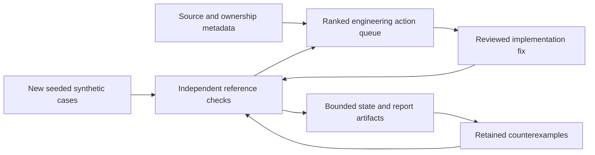

# Continuous improvement loop

The project now automates regression discovery, evidence-readiness review and
next-action prioritization. It does not autonomously write correct code, fit
strategies, read held-out outcomes, merge changes, place orders or contact anyone.
Those capabilities must not be inferred from a scheduled workflow.



## What happens automatically

The [workflow](../.github/workflows/self-review.yml) runs daily at00:47UTC
(08:47Shanghai), on relevant main/research pushes, and by manual dispatch. GitHub
schedules can be delayed or skipped; this is review automation, not precision
market acquisition or a guarantee of continuous uptime.

Each run generates1,000 reproducible synthetic parameter cases using its run ID
as the seed. It compares replay fills, fees, residual inventory and closed cash
against separately calculated Decimal reference arithmetic. It exercises buys,
sells, abstentions, zero/partial depth and multiple assumed fee levels. This
searches for engineering counterexamples; it does not search for profitable
strategy parameters or estimate alpha.

Previously failing cases are replayed first. Unresolved cases remain in state;
resolved case IDs are reported. New parameter-case IDs are tracked within a
rolling10,000-ID window, and the last30 reviews are retained. These are parameter
cases, not10,000 independent market observations or a lifetime uniqueness claim.
The generator is not a proof that the implementation is correct on all inputs.
The independent arithmetic shares the strict decimal parser with replay; it is
not an independently sourced exchange-fill model.

The same run verifies successor source readiness and declared model-file hashes and optionally refreshes public
Git ownership references. Slots still within their original start allowance are
not classified as overdue. Unclaimed slots become an investigation item, not a
zero return or automatic retry. Open release gates trigger a publication-check
recommendation, never a report read or an alpha conclusion.

## State, reports and failures

Main-branch runs restore/save `.self-review/state.json` through a pinned Actions
cache. Branch runs do not share that cache. Workflows are serialized per ref;
run only one local writer per state file. State is JSON data with a strict schema
and bounded size; it cannot supply executable code or destination paths.

Cache storage is best-effort and can expire or be evicted. A missing cache is
explicitly reported as a cold start. It must not be advertised as uninterrupted
learning. Each run also uploads a checksummed review/state artifact configured
for90-day retention. These are maintenance reports, not a replacement for the
project's long-term scientific Release archives.

Genuine reference/source failures fail the workflow after preserving replayable
cases. Pending study gates, unclaimed slots and unavailable network metadata are
reported as evidence gaps; they do not independently fail the workflow. Green
review status therefore means its engineering checks passed, not that collection
is healthy or the strategy profitable. Invalid state is rejected rather than
silently reset. Raw exception text, credentials and private signals are not stored.

## Inspect, stop and resume

Open [continuous research review](https://github.com/evananann/crypto-exec-lab/actions/workflows/self-review.yml)
for the latest run summary and downloadable artifact. The published dashboard
links this workflow. Its embedded research figures remain explicitly dated;
the daily review does not silently replace them with new estimates.

To stop scheduled execution, open that workflow in Actions and select **Disable
workflow**. Re-enable it and use **Run workflow** to resume. Keep the cache/state
for continuity. Before clearing incompatible state, save its artifact and record
that history will cold-start. No hidden trading process remains running.

## Reproduce locally

```bash
uv run --frozen python -m research.roadmap.self_review --seed 42 --cases 1000 --state /tmp/review-memory/state.json --out data/raw/review-first --refresh-claims
uv run --frozen python -m research.roadmap.self_review --seed 43 --cases 1000 --state /tmp/review-memory/state.json --out data/raw/review-second
uv run --frozen python -m unittest tests.test_self_review -v
```

The second command reuses history. Omit `--refresh-claims` for fully offline
operation. To replay retained failures after a fix, supply the preserved
`state.json` and a fresh output path. Tests inject a reference failure, verify
that its case is retained, then verify replay and resolution with the correct
implementation. No actual financial bug is claimed by that injected test.

Actual self-modifying code repair or autonomous research-model promotion is not
implemented. The review creates evidence and a repair queue; a reviewer/agent
must make and validate changes. New empirical enrollment and model promotion
retain their preregistration, data eligibility and independent validation gates.
