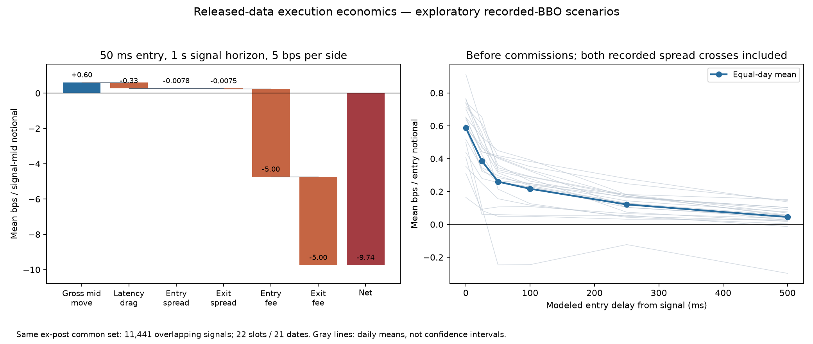

# Empirical latency and execution-cost breakdown

[One-page trading memo](MEMO.md).

**Post-release exploratory supplement. Trading decision: DO NOT DEPLOY.**
The original frozen conclusion remains `inconclusive_missing_coverage_or_precision`.
These are isolated recorded-book counterfactuals, not observed exchange fills,
independent trades, portfolio returns or a Binance-versus-OKX-only ablation.
Each hypothetical order opens and closes on OKX using the fixed Binance $2
leader trigger. There is no hedge order on Binance.

## Result on the stricter common set

At a modeled 50 ms entry delay and 5 bps commission per side:

- Price-only full round trip, both recorded spread crosses included: **+0.2604 bps / entry notional**.
- After both assumed commissions: **-9.7397 bps / entry notional**.
- Algebraic fee at zero mean: **+0.1302 bps per side**, using the signal-mid-normalized return. This is a hypothetical boundary, not an available account tier or a maker strategy.
- Available derivative sample: **22/56 scheduled slots, 21 dates, 11,441 overlapping signals**.



[Figure PDF](latency-cost.pdf) · [All aggregates and performance](analysis.json) · [Every slot, rejection and first common trace](session-results.json) · [Fixed protocol and source hashes](protocol.json).

At 50 ms, 20/21
available dates have a positive price-only round-trip mean;
21/21
have a negative mean after 5 bps per side. [Date leverage diagnostics](date-diagnostics.json)
report every leave-one-observed-date-out mean, without promoting them to intervals
or repairing missing dates.

The waterfall uses signal-mid notional to make every component additive. The
latency curve and table use entry notional; their denominators are labeled and
must not be mixed. Latency drag is signed and may be beneficial. Exit fees use
exit notional, so subtracting exactly twice the fee rate can be wrong.

## Every fixed fee/delay scenario

Equal-day mean full-round-trip bps per entry notional. A fee is charged on **each** fill.

| Delay ms | 0 bps/side | 1 bps/side | 3 bps/side | 5 bps/side |
| ---: | ---: | ---: | ---: | ---: |
| 0 | +0.5879 | -1.4121 | -5.4121 | -9.4121 |
| 25 | +0.3860 | -1.6140 | -5.6140 | -9.6140 |
| 50 | +0.2604 | -1.7396 | -5.7397 | -9.7397 |
| 100 | +0.2167 | -1.7833 | -5.7833 | -9.7833 |
| 250 | +0.1215 | -1.8785 | -5.8785 | -9.8785 |
| 500 | +0.0454 | -1.9546 | -5.9546 | -9.9546 |

All cells use the same within-session common signal set and same eligible dates.
The fixed one-second horizon is measured from the signal: entry delay shortens
the holding period. No cell is selected as an optimized strategy.

## Coverage and denominator control

| Phase | Scheduled | Original eligible | Supplement available | Dates | Common signals |
| --- | ---: | ---: | ---: | ---: | ---: |
| development | 42 | 20 | 19 | 18 | 8345 |
| holdout | 14 | 3 | 3 | 3 | 3096 |
| full | 56 | 23 | 22 | 21 | 11441 |

The original full-cohort primary was **-4.6954 bps**
after one entry fee on 23/56 slots, marked to mid rather than an executable exit.
Its approximately +0.305 bps before that fee is not the gross component in this
stricter-subset waterfall. Every usable session's price-only 50 ms / 5 bps primary
was independently reproduced against the original pinned report before the
depth/common-set restrictions were applied.

The supplement rejects an entire session on recorded ordering regressions,
sequence conflicts, unknown units or incompatible original instrument metadata.
It never sorts timestamps. Every excluded scheduled slot is listed below. Missing
observations do not become zero P&L. The original study and its eligibility are
unchanged; these derivative restrictions do not repair missing coverage.

The original available primary label count is **21,388**;
**8,460** of those labels belong
to derivative-unavailable sessions. [Label coverage](label-coverage.json) makes
this attrition explicit. Source-quality filtering can be regime selective: a
high-volume session can contribute many labels even though day weighting limits
its mean weight. Results on the retained set must not be generalized to the
excluded bursty period or the unrecorded slots.
The scan covered all **23 original eligible
tapes / 10,753,415 event records**, not only the
prefix examined in the earlier timestamp diagnosis.

The common set requires sufficient quotes/depth at all modeled arrivals and exit.
That is **ex-post measurement conditioning**, not a trading rule: actual decisions
cannot know future liquidity. Within-bucket market-before-timer priority follows
the frozen convention; at signal/zero-delay, later-written same-ms quotes are
excluded. Software millisecond clocks cannot establish submillisecond arrival or
physical price-discovery lead. Independent UTC accuracy is not certified.

## Engineering improvements and practical limits

Only one authenticated original archive is in flight. Parsing retains BBO fields
needed for lookup; raw streams are not accumulated. Each delay builds exact-decimal
price components once and reuses them across four fee scenarios, with separate
cash-cost checks for every cell. Publication regenerates from saved session
aggregates without re-downloading or re-estimating tapes.

Measured successful authenticated restore time, cumulative across contributing attempts: **576.0 s**;
replay time: **120.8 s**.
Current-invocation peak process high-water RSS: **2975.1 MiB**.
Current invocation only; the interrupted prefix peak was not recorded.
These are this run's measurements, not a general throughput guarantee.

The protocol records any resumed prefix. Cached local outputs are accepted only
with unchanged economics and matching pinned original identities; their prefix
digest is reproducible from `session-results.json`. They are not represented as
independently re-executed in the resumed invocation. New downloads use isolated
staging and bounded retries for transport failures; source/authentication checks
are retained. Neither a retry nor a checkpoint can turn missing data into returns.

A separate [synthetic arithmetic microbenchmark](engineering-benchmark.json) measured a median direct/shared runtime ratio of 1.53 across three alternating-order repetitions, with identical scenario outputs. This measures only component arithmetic, not end-to-end replay or network throughput.

Recorded displayed depth is not fill probability. There is no calibrated race,
queue depletion, market impact, funding, margin or liquidation model. Correlated
overlapping signals are not independent observations, and no Sharpe ratio,
confidence interval or profitability claim is produced. A positive zero-fee or
conditional sample mean does not establish incremental Binance information.

## Unavailable original slots

| Slot | Status | Reason |
| --- | --- | --- |
| 2026-10-26-pm | ORIGINAL_UNAVAILABLE | missing verified archive; not a zero return |
| 2026-10-27-pm | ORIGINAL_UNAVAILABLE | missing verified archive; not a zero return |
| 2026-10-28-pm | ORIGINAL_UNAVAILABLE | missing verified archive; not a zero return |
| 2026-10-29-pm | ORIGINAL_UNAVAILABLE | missing verified archive; not a zero return |
| 2026-10-30-pm | ORIGINAL_UNAVAILABLE | missing verified archive; not a zero return |
| 2026-10-31-pm | ORIGINAL_UNAVAILABLE | missing verified archive; not a zero return |
| 2026-11-01-pm | ORIGINAL_UNAVAILABLE | missing verified archive; not a zero return |
| 2026-11-02-pm | ORIGINAL_UNAVAILABLE | missing verified archive; not a zero return |
| 2026-11-03-pm | ORIGINAL_UNAVAILABLE | missing verified archive; not a zero return |
| 2026-11-04-pm | ORIGINAL_UNAVAILABLE | missing verified archive; not a zero return |
| 2026-11-05-pm | ORIGINAL_UNAVAILABLE | missing verified archive; not a zero return |
| 2026-11-06-am | ORIGINAL_UNAVAILABLE | missing verified archive; not a zero return |
| 2026-11-06-pm | ORIGINAL_UNAVAILABLE | missing verified archive; not a zero return |
| 2026-11-07-pm | ORIGINAL_UNAVAILABLE | missing verified archive; not a zero return |
| 2026-11-08-pm | ORIGINAL_UNAVAILABLE | missing verified archive; not a zero return |
| 2026-11-09-pm | ORIGINAL_UNAVAILABLE | missing verified archive; not a zero return |
| 2026-11-10-am | ORIGINAL_UNAVAILABLE | missing verified archive; not a zero return |
| 2026-11-10-pm | ORIGINAL_UNAVAILABLE | missing verified archive; not a zero return |
| 2026-11-11-pm | ORIGINAL_UNAVAILABLE | missing verified archive; not a zero return |
| 2026-11-12-pm | ORIGINAL_UNAVAILABLE | missing verified archive; not a zero return |
| 2026-11-13-am | UNAVAILABLE_RECORDED_STREAM_INTEGRITY | global_receive_regression |
| 2026-11-13-pm | ORIGINAL_UNAVAILABLE | missing verified archive; not a zero return |
| 2026-11-14-pm | ORIGINAL_UNAVAILABLE | missing verified archive; not a zero return |
| 2026-11-15-pm | ORIGINAL_UNAVAILABLE | missing verified archive; not a zero return |
| 2026-11-16-am | ORIGINAL_UNAVAILABLE | unhealthy, late or failed original attempt |
| 2026-11-16-pm | ORIGINAL_UNAVAILABLE | missing verified archive; not a zero return |
| 2026-11-17-am | ORIGINAL_UNAVAILABLE | missing verified archive; not a zero return |
| 2026-11-17-pm | ORIGINAL_UNAVAILABLE | missing verified archive; not a zero return |
| 2026-11-18-pm | ORIGINAL_UNAVAILABLE | missing verified archive; not a zero return |
| 2026-11-19-am | ORIGINAL_UNAVAILABLE | unhealthy, late or failed original attempt |
| 2026-11-19-pm | ORIGINAL_UNAVAILABLE | missing verified archive; not a zero return |
| 2026-11-20-pm | ORIGINAL_UNAVAILABLE | missing verified archive; not a zero return |
| 2026-11-21-am | ORIGINAL_UNAVAILABLE | unhealthy, late or failed original attempt |
| 2026-11-21-pm | ORIGINAL_UNAVAILABLE | missing verified archive; not a zero return |

## Reproduce

```sh
uv run --frozen python -m research.roadmap.latency_report --primary-archive /path/to/successor-report-45020145212-1.tar.gz --cache /tmp/new-original-cache --out /tmp/new-latency-analysis
uv run --frozen python -m research.roadmap.latency_publication --source /tmp/new-latency-analysis --out /tmp/new-latency-publication
```

The first command requires GitHub read access to the original public archives.
The second needs only saved, completed outputs and rejects aggregation drift.
If a download interrupts replay, rerun the first command with fresh output/cache
directories and `--resume /path/to/the/interrupted/output`. It validates the
unchanged economics, chronological prefix and original identities before reuse.
No credentials are needed to inspect the committed report. Server setup stays parked.
