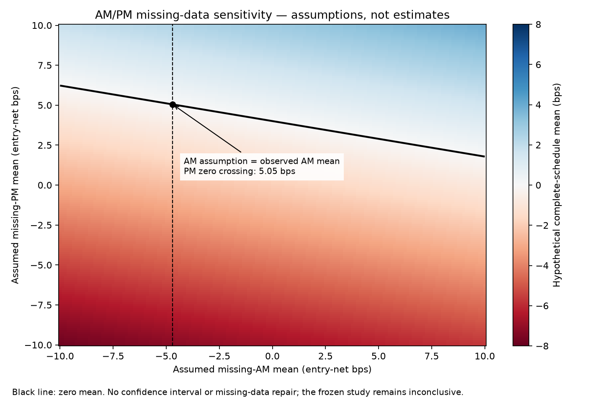

# Released-study missing-data frontier

**Trading decision unchanged: DO NOT DEPLOY. Frozen conclusion remains `inconclusive_missing_coverage_or_precision`.**

The observed result does not identify the mean over all planned sessions. Of 28
AM and 28 PM slots, only 22 AM and one PM produced eligible primary outcomes.
This supplement asks how favorable the unknown slots would need to be to change
the sign. It does not estimate or impute their outcomes, select a policy or refit
the frozen model. All values are the original 50 ms / 5 bps entry-net, one-second
entry-to-mid metric, not realized portfolio returns.

## Measured inputs and conditional arithmetic

- Observed equal-occupied-day mean: **-4.6954 bps**.
- Observed equal-slot mean: **-4.7016 bps**. It differs because one observed day contains two slots.
- If all 33 missing slots share one assumed mean, a **+3.2769 bps** missing mean brings the hypothetical complete balanced schedule to zero. This reproduces the existing frozen equal-slot sensitivity.
- If the six missing AM slots instead match the observed AM mean (**-4.6965 bps**), the 27 missing PM slots need an average **+5.0488 bps entry-net** to reach zero. That is **+10.0488 bps before the assumed entry fee**, still including bid/ask entry effects and excluding executable exit costs.

The complete-schedule expression is `(observed slot sum + 6*assumed AM mean + 27*assumed PM mean) / 56`.
With two planned slots every day, this equals an equal-day mean over the full
planned calendar. It is a counterfactual sensitivity target, not a replacement
for the frozen observed occupied-day statistic.

| Assumed missing-AM mean (bps) | Missing-PM mean needed for zero (bps) |
| ---: | ---: |
| -10 | 6.2273 |
| -5 | 5.1162 |
| 0 | 4.0051 |
| 5 | 2.8940 |
| 10 | 1.7829 |



[Standalone figure PDF](am-pm-frontier.pdf) · [Original slot outcomes, phase results and conditional regions](sensitivity.json).

## What can and cannot be concluded

The black boundary shows which **assumed** missing-AM/PM combinations change
the complete-schedule sign. It does not make positive PM outcomes likely. A
single observed PM session cannot establish a PM distribution or an AM/PM
regime difference. The same source report supplies separate development and
holdout calculations; those phases are not pooled to select a winner.

The JSON also supplies sharp identification regions conditional on every missing
session lying in each fixed assumed range (±1, ±2, ±5, ±10 bps). Endpoints are
attainable under those assumptions. These ranges have no empirical calibration;
they are not confidence intervals, and a negative conditional upper endpoint
does not change the frozen scientific decision. Without justified outcome bounds,
the missing contribution is unbounded and the full-schedule sign is unidentified.

The narrow observed-day confidence interval therefore cannot settle the missing
PM question. Rejecting deployment is justified; declaring that all sessions or
all cross-venue strategies lose is not. No incremental Binance effect is tested.

## Reproduce

Use original report archive `successor-report-45020145212-1.tar.gz` from the existing
`study-archive-btc-execution-v1` Release, then:

```sh
uv run --frozen python -m research.roadmap.missingness_frontier --archive /path/to/successor-report-45020145212-1.tar.gz --out /tmp/new-missingness-frontier
```

The CLI checks release/source gates before archive traversal, verifies the pinned
original archive/report hashes, reconstructs only the fixed primary cell for each
original slot, and cross-checks occupied-day means and common missing-mean tipping
points against the frozen report. Original files and study decisions are unchanged.
