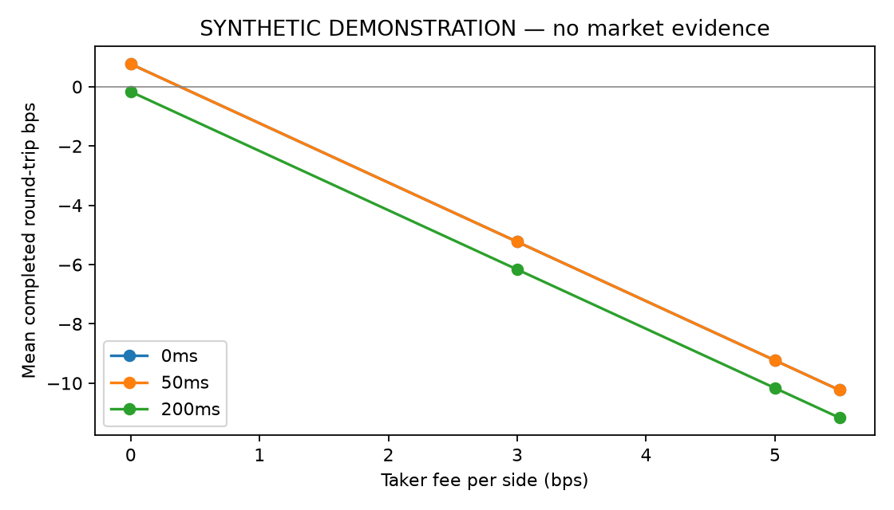
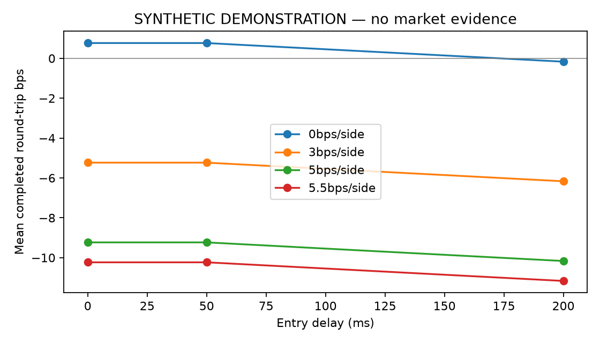
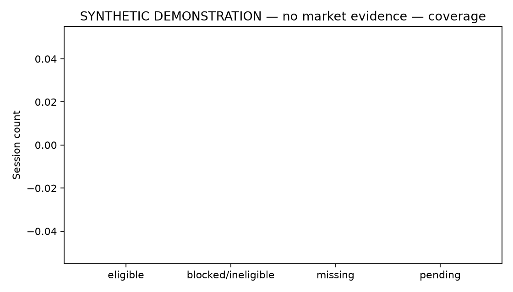

# Synthetic pipeline demonstration

These figures use a deterministic constructed 12-minute tape with a known
200ms follower lag. **They are not live market results or evidence of alpha.**
No v1 or v2 holdout data was used.

Generated from clean commit `46aa9ed815ea4e2bdbe62fb14cacd7da0215dafd`:

```bash
uv run --frozen python -m cel.experiments --demo --out data/raw/portfolio-published-demo
```

[summary.json](summary.json) records source and input SHA-256 values, runtime,
fixed parameters, controls and fill-audit outcomes. The complete local bundle
also contains the tape, full fills and checksum inventory. CI publishes the
complete synthetic bundle as an artifact for each supported Python version.
Use a fresh output directory to reproduce it.

The cost and latency plots show descriptive completed-trade means. Inspect
unfinished inventory, sample counts and total MTM in the JSON alongside them.
Curves may overlap on constructed data.
Coverage shows zero real eligible sessions because the input is synthetic;
it is not the live study's session inventory.






