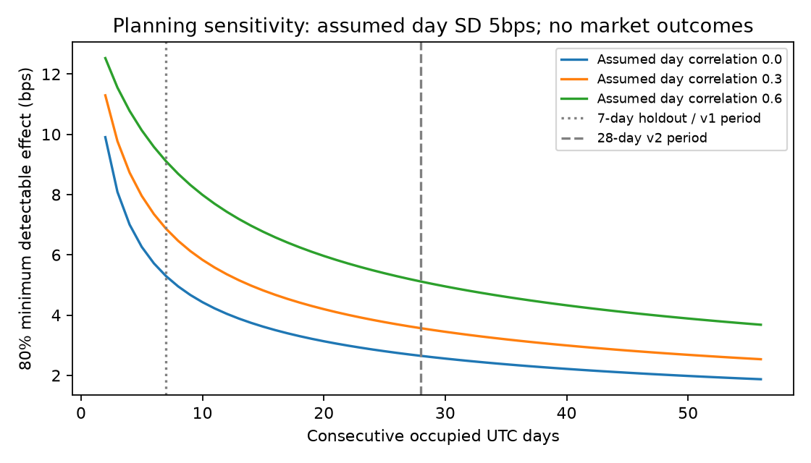

# Pre-results research audit evidence

Generated October 17, 2026 from clean commit `577b545bc9f8183fee1a1a4955fe35e00773b1ab` using Python 3.12.14.
All 191 local tests passed, Ruff passed and all three frozen source maps verified.
The [validation record](validation.json) preserves the commands and scope.
[Hosted CI](https://github.com/evananann/crypto-exec-lab/actions/runs/39022493045)
also passed the Python 3.11/3.12/3.13 matrix, including both audit CLIs.

- [Power table](power/power.md), [JSON](power/power.json) and [figure](power/power.png):
  54 prospective variance/dependence scenarios; no fitted market parameters.
- [Execution table](execution/execution.md) and [JSON](execution/execution.json):
  eight synthetic follower round trips and six two-leg stress cases, with
  source/input hashes and independent round-trip fill/accounting checks.
- [Checksums](checksums.json): exact file digests for these generated records.

Power uses a known-variance normal model, not the frozen bootstrap. Synthetic
execution outcomes are not measured alpha or failure probabilities. This is
an audit directory, not an `experiments.json` research bundle. The source commit
identifies the generator; later documentation commits do not relabel its source.
See the [power review](../../docs/STATISTICAL_POWER_AUDIT.md) and
[execution review](../../docs/EXECUTION_ASSUMPTION_AUDIT.md) for interpretation.
